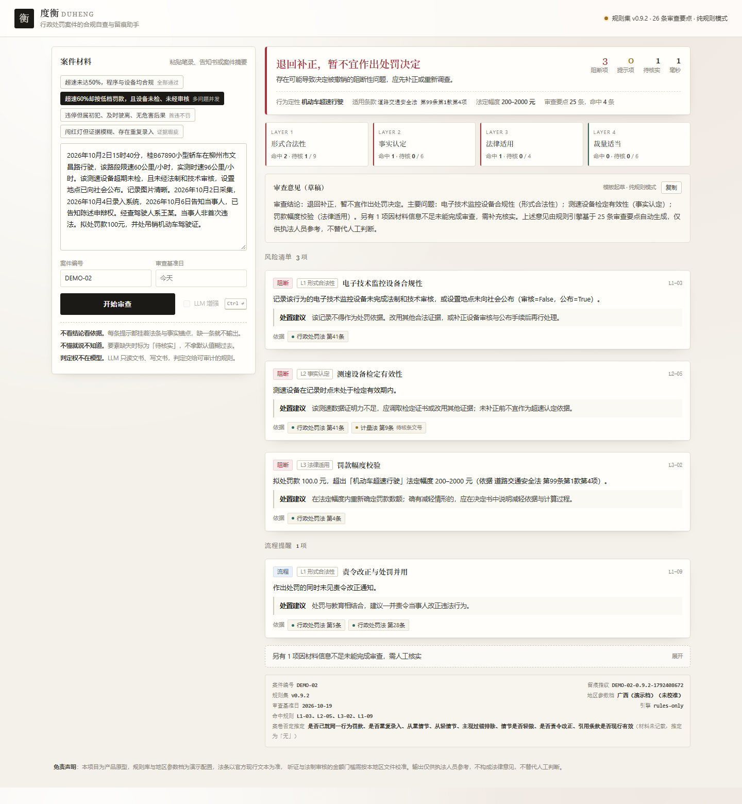

# 度衡 DuHeng

**行政处罚案件的合规自查与留痕助手。**
让 LLM 只做书记员（读文书、写文书），把判定权交给可审计的规则引擎——
每条结论都挂着法条与事实依据，说不清依据的结论一律不输出，说不准的依据明确标注。



> 一个交通非现场执法案件进入系统，25–26 条审查要点按
> **形式合法性 → 事实认定 → 法律适用 → 裁量适当** 四层依次过一遍，
> 输出风险清单、处置建议、审查意见草稿和一条完整的审查留痕。

---

## 为什么做这个

大模型进了法律场景，最先死掉的不是"答错"，而是**无法追责**：

| 痛点 | 具体表现 | 谁在疼 |
|---|---|---|
| 幻觉 | 法条号是编的，说理看着通顺但查无此条 | 执法人员、法制审核员 |
| 不可审计 | 模型说"该案程序违法"，但没人知道它依据什么 | 行政复议、诉讼中的被告 |
| 假确定性 | 信息不足时模型硬给一个结论，风险被 False 吞掉 | 基层执法单位 |
| 黑箱裁量 | 直接问"该罚多少"，模型给出的数字无法核验 | 过罚相当原则 |

法律 AI 的正确姿势不是"更聪明的回答"，而是**每句话都能被追责**。
度衡把这条原则做成了四个工程机制：

### 1. LLM 不做法官，只做书记员
LLM 只承担两件事：把文书读成结构化事实（抽取），把结构化结论写成可读的审查意见（表达）。
**判定全部由规则引擎完成**——规则、阈值、法条依据都在 JSON 里，可读、可改、可审计。
没配 LLM 密钥时自动降级为纯规则模式，功能完整可用。

### 2. 三值逻辑：把「不知道」从 False 里救出来
事实字段缺失时，规则**既不通过也不违规**，而是返回"未知"，单独归入「待核实」清单。
宁可多写一句"因材料信息不足未能审查"，也不把没查清的事当成查清了。
这条设计后来在压力测试中救了 2 个用例（见 [评测报告](docs/03-评测报告.md)）。

### 3. 案卷否定推定，推定必须显性
"是否已就同一行为罚款""有无从重情节"这类本应记载于案卷的事项，案卷未记载即推定为「无」——
但每一次推定都记录在案，随结果返回并在界面标注，**绝不把假设伪装成事实**。

### 4. 依据可信度分级
每条规则的法条依据带 `high / medium` 两级置信度：
`high` 表示条文号已核对；`medium` 表示规范名称已核、条文号待核——
界面上会挂一个「待核条文号」小标。**法律 AI 幻觉无法根治，但可以被标注、被拦截、被人工兜底。**

---

## 快速开始

```bash
git clone https://github.com/<your-name>/duheng-legal-audit-agent.git
cd duheng-legal-audit-agent
python app.py          # Python 3.10+，零第三方依赖
# 打开 http://127.0.0.1:8000
```

- **不配密钥**：纯规则模式，全部功能可用（推荐先这样跑）。
- **上传自己的案卷**：界面点「上传案卷文件（.txt / .docx）」，或直接把案件事实粘贴进文本框，点「开始审查」。
- **可选 LLM**：设置 `DUHENG_LLM_BASE` / `DUHENG_LLM_KEY` / `DUHENG_LLM_MODEL`
  （OpenAI 兼容接口），抽取与文书草稿切换为 LLM 起草、规则校验。

跑评测：

```bash
python -m evals.run_eval                  # 干净测试集（30 例）
python -m evals.run_eval --set stress_cases   # 脏数据压力集（8 例）
```

---

## 评测：同一套引擎，两张成绩单

| 数据集 | 规则召回 | 规则精确 | 结论一致率 | 要素抽取准确率 |
|---|---|---|---|---|
| 干净测试集（30 例，规范化改写） | **100%** | **100%** | **100%** | 100% |
| 脏数据压力集（8 例：OCR 噪声 / 汉字数字 / 口语化 / 否定嵌套） | **80%** | **57.1%** | **50%** | 66.7% |

干净数据上的满分说明不了什么——**那批用例和规则是同一批人写的，存在同源乐观偏差**。
真正有价值的是压力集：它把瓶颈精确定位到「要素抽取」而不是「规则逻辑」，
直接决定了 Roadmap 的优先级排序（见下）。
完整指标口径、逐条误差分析和两处标注修正过程见 [docs/03-评测报告.md](docs/03-评测报告.md)。

---

## 项目结构

```
├── app.py                  # 本地服务（标准库实现，零依赖）
├── core/
│   ├── engine.py           # 四层审查引擎 + 案卷否定推定
│   ├── expr.py             # 三值逻辑表达式求值器
│   ├── extract.py          # 规则抽取器（可离线）
│   └── llm.py              # 可选 LLM 层（OpenAI 兼容，带降级）
├── rules/                  # ★ 全部法律判断在这里，代码只是解释器
│   ├── audit_rules.json    # 26 条审查要点（含依据与置信度）
│   ├── behaviors.json      # 行为→条款→罚款区间→必填要素
│   └── region_profiles.json# 地区参数档（时效/听证门槛等）
├── data/
│   ├── golden_cases.json   # 30 例干净测试集
│   ├── stress_cases.json   # 8 例脏数据压力集
│   ├── cases_dataset.json  # 30 例场景数据集（4 类行为 × 6 类焦点）
│   ├── DATASET_README.md   # 数据集构成、来源等级与真实数据导入流程
│   └── sample_cases.json   # 界面演示用例
├── evals/run_eval.py       # 评测脚本（可复现全部数字）
├── tools/import_real_cases.py  # 真实决定书导入：清洗 + 脱敏 + 并入数据集
├── web/                    # 单页界面（无框架、无构建，支持上传 .txt/.docx）
└── docs/                   # PRD、指标体系、评测报告、迭代日志、竞品分析
```

新增一种违法行为 = 往 `behaviors.json` 加一段配置，**不改一行引擎代码**；
新增一条审查要点 = 往 `audit_rules.json` 加一条规则，评测集自动覆盖。

---

## Roadmap（按评测结论排序）

1. **抽取层重写**：正则 → LLM 结构化输出（JSON Schema 约束 + 置信度字段），
   目标：压力集要素抽取准确率 66.7% → 90%+。
2. **脏数据集扩容**：8 例压力集 + 30 例场景集已就绪，下一步从脱敏真实案卷构造
   （合规渠道导出 → `tools/import_real_cases.py`），消除同源偏差。
3. **地区参数档实测校准**：听证/法制审核门槛对接本地文件，去掉「未校准」标。
4. **留痕导出**：一键生成审查留痕 PDF（含规则版本与指纹），直接进案卷。
5. **更多执法领域**：市场监管（"首违不罚"场景，规则结构与交通领域可复用）。

---

## 文档导航

- [产品定义与用户](docs/01-产品定义与用户.md)
- [指标体系](docs/02-指标体系.md)
- [评测报告](docs/03-评测报告.md)
- [迭代日志](docs/04-迭代日志.md)
- [竞品与差异化](docs/05-竞品与差异化.md)

---

## 作者

法学本科生，辅修计算机科学与技术。关注法律规则的可计算表达，以及 AI 在行政执法中如何做到「可追责地落地」。
本项目源于法律规则计算机表达竞赛作品「交通非现场执法自动化合规审查智能体」的工程化重构。

**免责声明**：本项目为产品原型，规则库与地区参数档为演示配置，法条以官方现行文本为准；
听证与法制审核的金额门槛需按本地区文件校准。输出仅供执法人员参考，不构成法律意见，不替代人工判断。

License: MIT
